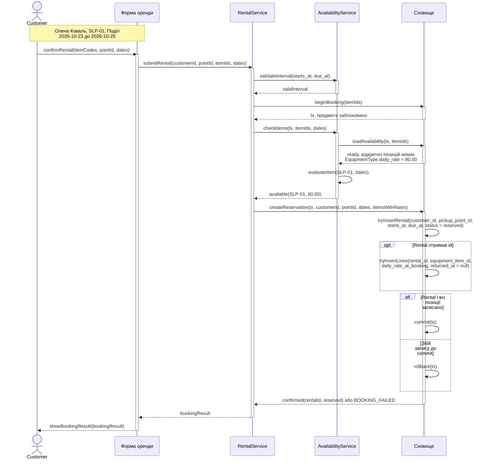
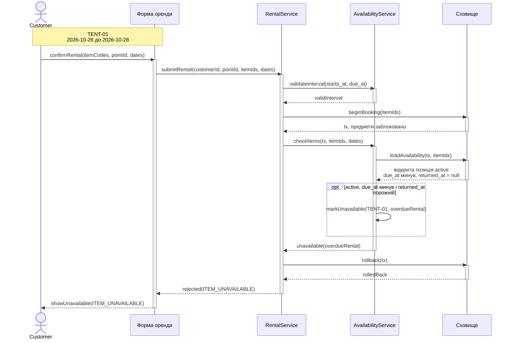
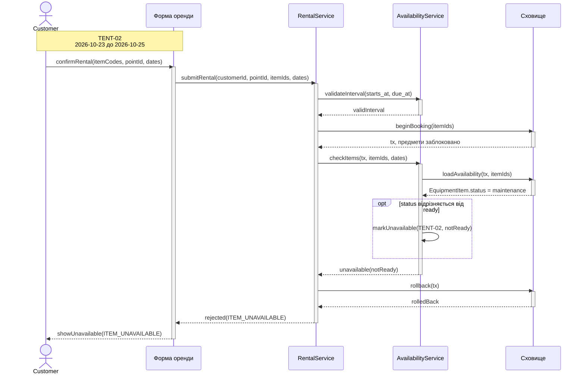
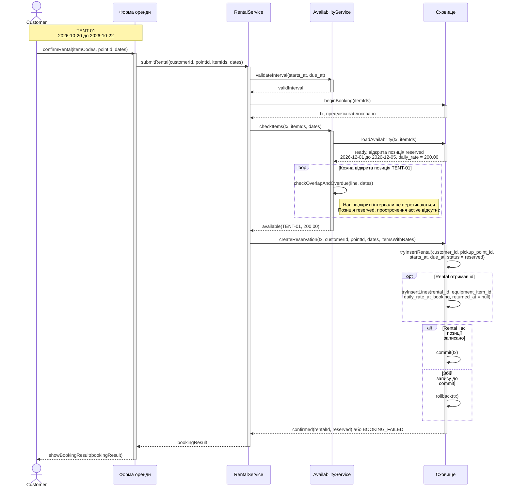
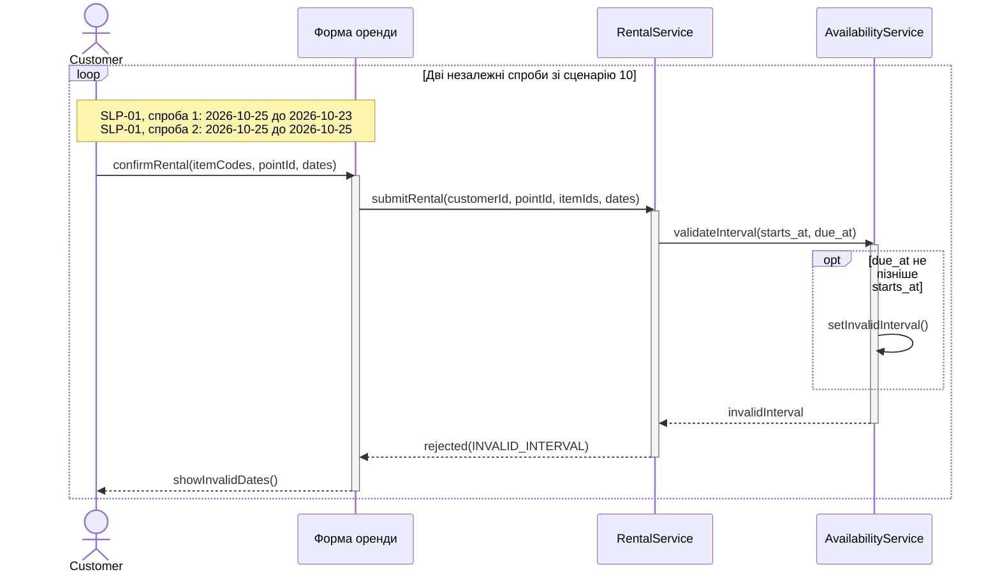
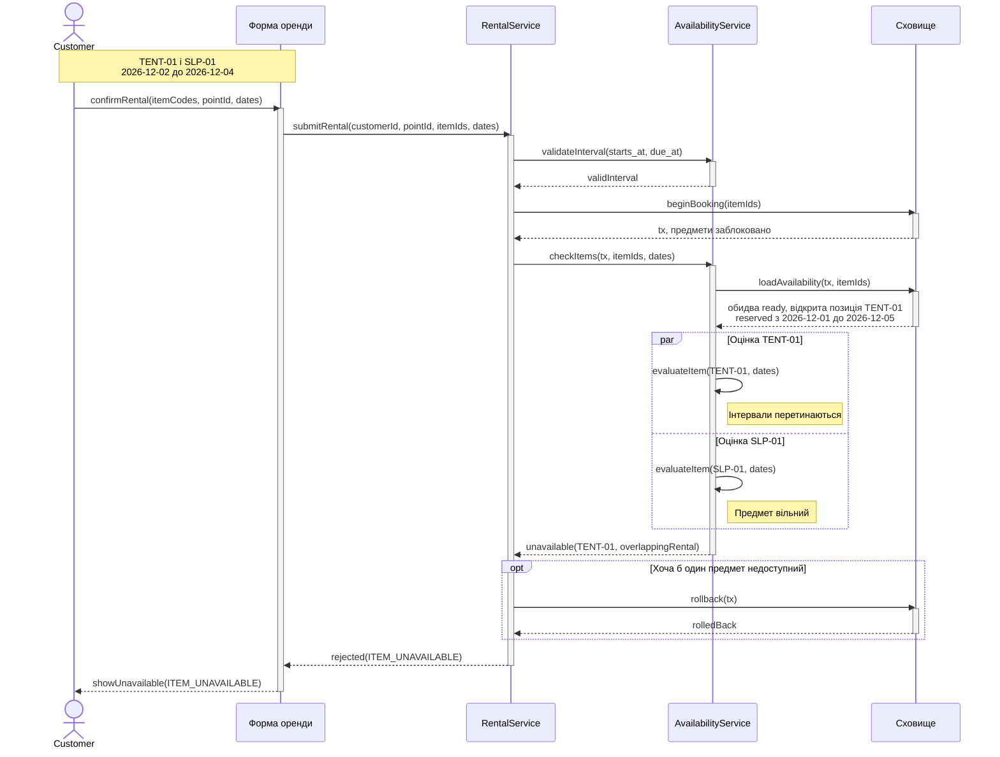

# Взаємодія під час оформлення оренди

UC-02 «Оформити оренду» включає UC-03 «Перевірити доступність предмета». Номери і назви нижче взято з [Gherkin](../lab-2/requirements.md#3-сценарії-gherkin) та [матриці](../lab-2/requirements.md#4-матриця-трасування).

Форма передає `customerId` з автентифікованого контексту. Сервіс оренди керує запитом, а сервіс доступності виконує UC-03 у два кроки: `validateInterval` та `checkItems` для валідних дат. Сховище на початку транзакції блокує рядки `EquipmentItem` за порядком ID, а перевірка читає актуальні дані після блокування. Активація сховища позначає виконання окремого виклику. Транзакція `tx` і блокування тривають до `commit` або `rollback`.

Відкрита позиція має `returned_at = null`. Доступність залежить від `EquipmentItem.status` і відкритих позицій `reserved` та `active`. Інтервали мають вигляд `[starts_at, due_at)`: спільна межа не створює перетину. Прострочена відкрита `active` займає предмет навіть за межами свого інтервалу.

## Сценарій 2. Бронювання вільного спальника записує погоджену ціну

REQ-03. Бронь Олени Коваль у пункті «Поділ» отримує статус `reserved`. У позицію `SLP-01` копіюється ціна 80.00.

## Сценарій 3. Неповернений намет не бронюють після due_at

REQ-02. Прострочена відкрита позиція `TENT-01` блокує навіть запит на дати після її `due_at`.

## Сценарій 4. Предмет у ремонті не додають до оренди

REQ-02. `TENT-02` недоступний через `EquipmentItem.status = maintenance`. Записів броні немає.

## Сценарій 9. Бронь на грудень не заважає жовтню

REQ-03. Груднева бронь `TENT-01` лишається чинною. Нова `reserved` має `starts_at = 2026-10-20` і `due_at = 2026-10-22`.

## Сценарій 10. Оренду з due_at не пізніше starts_at відхиляють

REQ-14. Один сценарій Gherkin містить два незалежні запити. Кожен завершується на перевірці інтервалу.

## Сценарій 12. Один зайнятий предмет відхиляє всю оренду

REQ-02. Перевірки `TENT-01` і `SLP-01` можуть виконуватися незалежно на вже прочитаних даних. Сервіс приймає рішення після обох перевірок. Для вільного `SLP-01` позиція теж не створюється.

## Звірка з ER-моделлю

| Зв'язок | Як видно у взаємодії |
| --- | --- |
| R1, R2 | `Rental.customer_id` і `pickup_point_id` посилаються на вибраного клієнта та пункт. |
| R3 | `EquipmentItem.equipment_type_id` визначає, з якого `EquipmentType` взяти `daily_rate`. |
| R4, R5 | `RentalLine.rental_id` вказує на нову оренду, `equipment_item_id` - на обраний предмет. Записується одна позиція на предмет. У ній фіксується `daily_rate_at_booking` і порожній `returned_at`. |
| R6 | Зв'язок `EquipmentType` з `Tag` використовується в каталозі й не бере участі в підтвердженні броні. |

Сховище працює із сутностями з [ER-моделі завдання 1](../lab-1/model.mmd). Форма і сервіси є учасниками взаємодії, а `tx` і коди відповіді існують під час виклику. Незмінність погодженої ціни після зміни каталогу (REQ-09) перевіряє сценарій 7 завдання 2 у UC-08.

## Нефункціональні вимоги

| Критерій | Де видно в моделі | Як перевірити після реалізації |
| --- | --- | --- |
| NFR-01 | `beginBooking` перед читанням, спільний `tx` до запису або відмови. Сценарії 2, 3, 4, 9, 12. | Одночасно підтвердити два запити різних клієнтів на той самий вільний предмет на дати з перетином. Очікувати одну нову бронь з однією позицією та одну відповідь `ITEM_UNAVAILABLE`. |
| NFR-02 | `commit` після всіх позицій, `rollback` при збої запису. Сценарії 2, 9. | Спричинити збій запису другої позиції після запису першої. Очікувати `BOOKING_FAILED` і 0 нових `Rental` та `RentalLine` для спроби. |
| NFR-03 | `overdueRental`, `notReady` та `overlappingRental` лишаються між сервісами. Сценарії 3, 4, 12. | Перевірити відповідь форми для трьох причин. Очікувати `ITEM_UNAVAILABLE` у всіх випадках і 0 полів іншого `Rental` та `Customer`. |
| NFR-04 | Від виклику `submitRental` до відповіді RentalService формі, включно з очікуванням блокування. Сценарії 2, 3, 4, 9, 12. | Виміряти p95 за навантаженням зі [специфікації](spec.md#нефункціональні-вимоги). Ціль - ≤ 500 мс. |
