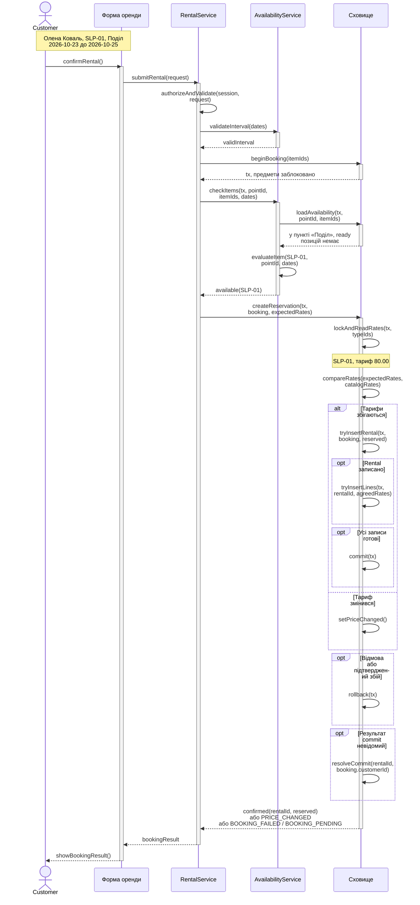
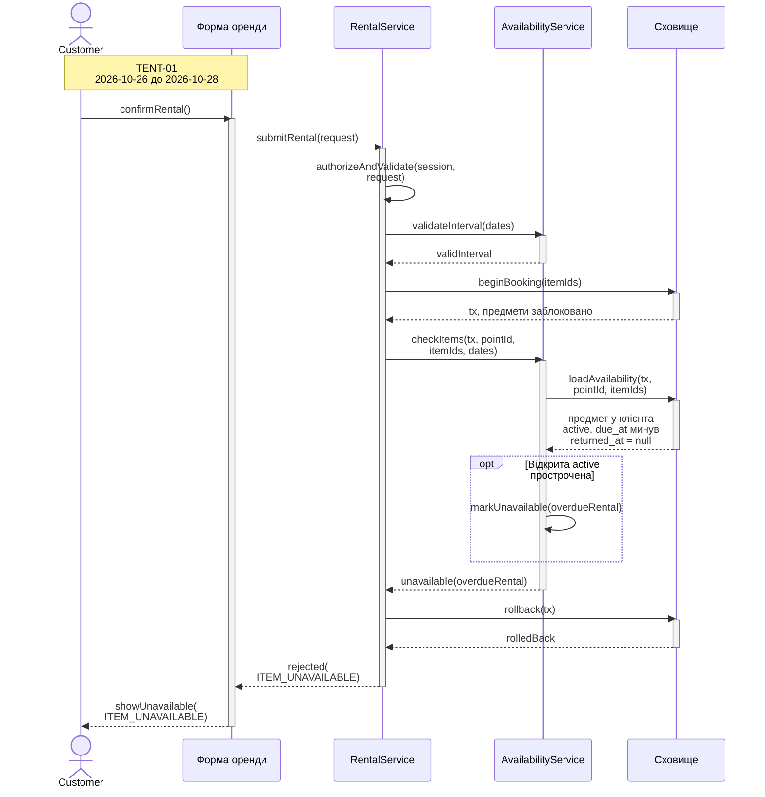
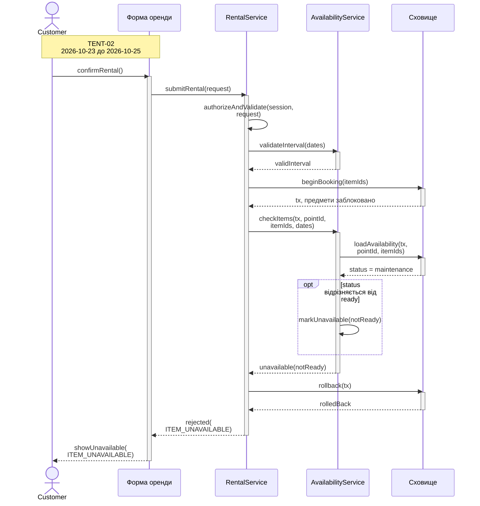
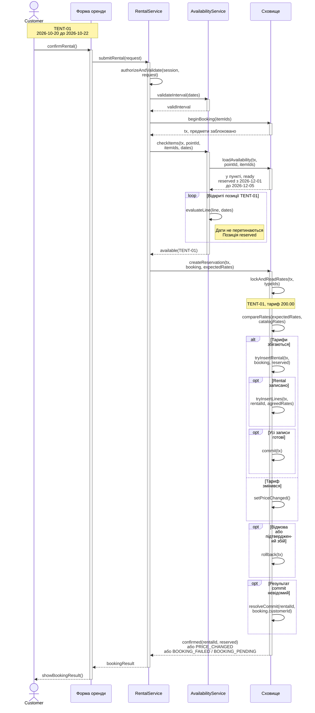
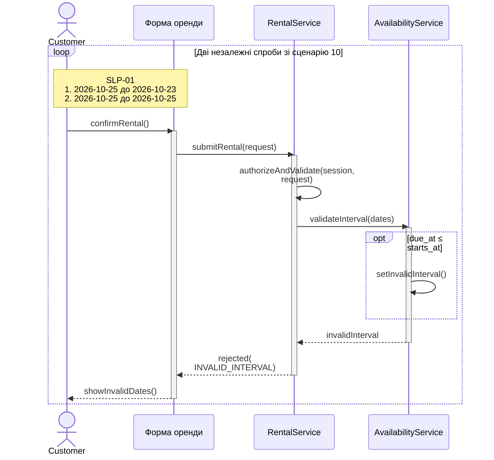
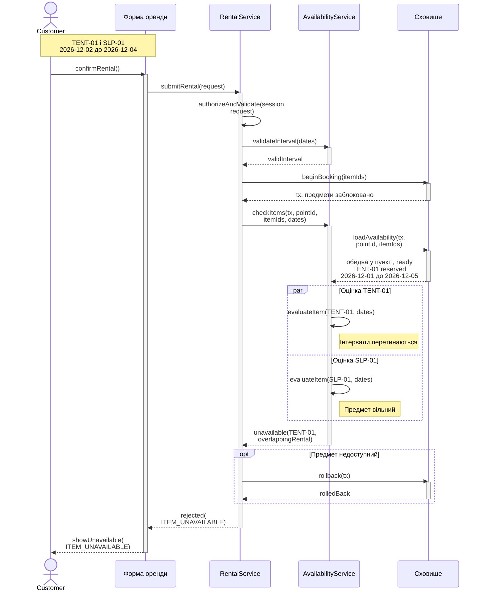

# Взаємодія під час оформлення оренди

UC-02 «Оформити оренду» включає UC-03 «Перевірити доступність предмета». Номери й назви сценаріїв відповідають завданню 2. [Gherkin](../lab-2/requirements.md#3-сценарії-gherkin) · [Матриця трасування](../lab-2/requirements.md#4-матриця-трасування)

## Правила бронювання

1. `RentalService` перевіряє сесію і визначає `Customer.id` на сервері. Без дійсної сесії, прив'язаної до клієнта, сервіс повертає `UNAUTHENTICATED`. Форма надсилає `pointId`, `itemIds`, `starts_at`, `due_at` та `expectedRates` з тарифами, показаними клієнту. Якщо в тілі є `customerId`, сервіс повертає `INVALID_REQUEST`.
2. `pointId` має бути UUID. `itemIds` має бути непорожнім списком UUID, унікальних після приведення до канонічної форми. Помилку у списку предметів повертають як `INVALID_ITEMS`. У `expectedRates` має бути рівно один додатний десятковий тариф за добу для кожного ID з `itemIds`. Неправильний `pointId` або набір `expectedRates` повертає `INVALID_REQUEST`. UC-03 приводить обидві дати до однієї часової шкали й перевіряє `due_at > starts_at`. Пропущені, нерозпізнані, рівні або зворотні дати повертають `INVALID_INTERVAL`. Перевірки форми й дат завершуються до відкриття транзакції.
3. `beginBooking` відкриває `tx` і бере ексклюзивні блокування рядків предметів за зростанням ID. Після цього `loadAvailability` окремим читанням отримує актуальні дані в тому самому `tx`. Сервіс повертає `INVALID_POINT`, якщо пункт відсутній. Для кожного `itemId` має існувати предмет зі станом `ready` і `current_pickup_point_id`, рівним `pointId`. Відкриті позиції (`returned_at = null`) в орендах `reserved` або `active` блокують інтервал `[starts_at, due_at)` за перетину дат. Прострочена оренда `active` з відкритою позицією блокує предмет і після `due_at`. На перевірку береться один поточний час сервера після блокування. Недоступність хоча б одного предмета, зокрема невідомого ID чи іншого пункту, дає `ITEM_UNAVAILABLE` для всього запиту.
4. Для доступних предметів сховище блокує пов'язані типи за зростанням ID, читає `EquipmentType.daily_rate` і звіряє його з `expectedRates`. Розбіжність повертає `PRICE_CHANGED`. Форма оновлює тарифи з каталогу й чекає нового підтвердження клієнта. При збігу сервіс записує перевірений `Customer.id` у `Rental.customer_id` і переносить прочитані тарифи в `RentalLine.daily_rate_at_booking`.
5. `Rental` і всі позиції фіксуються разом. При відмові або збої до фіксації сховище відкочує відкриту транзакцію, зокрема коли помилка сталася під час блокування або читання. Форма отримує підтвердження після успішного `commit`. Якщо відповідь на `commit` втрачено, сервіс звіряє результат. Поки результат невідомий, форма отримує `BOOKING_PENDING` і `rentalId` для звірки за тією самою сесією. [ADR](adr/0001-reservation-transaction.md#наслідки)

На діаграмах `authorizeAndValidate` охоплює сесію та перевірку форми. `booking` містить серверний ID клієнта й перевірені дані оренди. Смуга активації сховища відповідає одному виклику, а `tx` тримає блокування до завершення транзакції.

## Сценарій 2. Бронювання вільного спальника записує погоджену ціну

REQ-03. Олена Коваль бронює `SLP-01` у пункті «Поділ». Сховище записує `reserved` для броні й ціну 80.00 для її позиції.

## Сценарій 3. Неповернений намет не бронюють після due_at

REQ-02. `TENT-01` лишився у клієнта після `due_at`, тому система відхиляє запит і на пізніші дати.

## Сценарій 4. Предмет у ремонті не додають до оренди

REQ-02. `TENT-02` у стані `maintenance`. Система відхиляє запит без записів броні.

## Сценарій 9. Бронь на грудень не заважає жовтню

REQ-03. Жовтневий інтервал не перетинається з грудневою бронню `TENT-01`. Система зберігає нову `Rental` зі статусом `reserved`, `starts_at = 2026-10-20` і `due_at = 2026-10-22`.

## Сценарій 10. Оренду з due_at не пізніше starts_at відхиляють

REQ-14. Клієнт робить дві спроби. Обидві закінчуються на перевірці інтервалу до звернення до сховища.

## Сценарій 12. Один зайнятий предмет відхиляє всю оренду

REQ-02. Сервіс може перевірити `TENT-01` і `SLP-01` паралельно на вже прочитаних даних. Після обох перевірок він відхиляє весь запит через зайнятий намет. Позиція для вільного спальника теж не створюється.

## Звірка з ER-моделлю

| Зв'язок | Як видно у взаємодії |
| --- | --- |
| R1, R2 | `Rental.customer_id` посилається на клієнта з перевіреної сесії. `Rental.pickup_point_id` посилається на обраний пункт видачі. |
| R3 | `EquipmentItem.equipment_type_id` визначає, з якого заблокованого `EquipmentType` взяти тариф. |
| R4, R5 | `RentalLine.rental_id` вказує на нову оренду, а `equipment_item_id` на обраний предмет. Сховище записує одну позицію на предмет, фіксує `daily_rate_at_booking` і лишає `returned_at` порожнім. |
| R6 | Зв'язок `EquipmentType` з `Tag` потрібен у каталозі. |
| R7 (доповнення завдання 3) | `EquipmentItem.current_pickup_point_id` є nullable UUID FK на `PickupPoint.id`. У предмета є 0 або 1 поточний пункт, а в пункту 0 або більше предметів. |

Поточний пункт береться з підтвердженого складського обліку. Видача чи передача в майстерню очищає `current_pickup_point_id`, а приймання предмета в пункті записує його ID. Для наявних предметів поле заповнюється за результатами звірки. Предмет із порожнім полем недоступний у будь-якому пункті. Якщо предмет видано, бронювання на пізніші дати можливе після фактичного повернення. Зміни місця відбуваються під тим самим блокуванням `EquipmentItem`, що й бронювання. [ER-модель завдання 1](../lab-1/model.mmd) · [ADR](adr/0001-reservation-transaction.md)

Унікальна пара `RentalLine(rental_id, equipment_item_id)` додатково захищає від дублювання позиції. Погоджена ціна зберігається в позиції, тому UC-08 читає її і після зміни каталогу (REQ-09, сценарій 7).

## Перевірки крайових випадків

Для кожної відмови очікується 0 нових `Rental` і `RentalLine` за цією спробою. Перевірки призначені для реалізації.

| Критерій | Випадок | Очікуваний результат |
| --- | --- | --- |
| C3 | Сесії немає або вона прострочена. | `UNAUTHENTICATED` до відкриття транзакції. |
| C3 | У сесії клієнта A в запиті передано `customerId` клієнта B. | `INVALID_REQUEST`. Повторний коректний запит у тій самій сесії створює бронь із `customer_id` клієнта A. |
| C3 | Окремо подати порожній `itemIds`, некоректний UUID і два записи того самого UUID у різному регістрі. | `INVALID_ITEMS` до відкриття транзакції в кожній спробі. |
| C3 | Подати коректні `itemIds` із пропущеним або некоректним тарифом для одного з предметів. | `INVALID_REQUEST` до відкриття транзакції. |
| C3 | Дата відсутня або має нерозпізнаний формат. | `INVALID_INTERVAL` до відкриття транзакції. Рівні й зворотні дати перевіряє сценарій 10. |
| C4 | Подати невідомий `itemId`, предмет з іншого пункту і предмет без підтвердженого місця в окремих запитах. У кожному запиті також є доступний предмет. | `ITEM_UNAVAILABLE` для всього запиту. Відповідь однакова в усіх трьох випадках. |
| C4 | Предмет видано, а нові дати починаються після `due_at` поточної оренди. | До фактичного повернення запит отримує `ITEM_UNAVAILABLE`. Після приймання в обраному пункті новий запит може створити бронь. |
| C4 | `pointId` має коректний формат, але пункту з таким ID немає. | `INVALID_POINT`. |
| C4 | Предмет `ready` є в обраному пункті, а попередня `reserved` закінчується рівно в `starts_at` нової. | Запит проходить перевірку дат і створює бронь. |
| C5 | Каталог змінює 80.00 на 100.00 до читання тарифу під блокуванням, а клієнт підтвердив 80.00. | `PRICE_CHANGED`. Після нового підтвердження 100.00 успішна бронь зберігає 100.00. |
| C5 | Зміна тарифу починається після читання 80.00 під блокуванням. | Зміна чекає завершення транзакції. Підтверджена `RentalLine` зберігає 80.00, і UC-08 показує цей тариф після зміни каталогу. |

## Нефункціональні вимоги

| Критерій | Де видно в моделі | Як перевірити після реалізації |
| --- | --- | --- |
| NFR-01 | `beginBooking` блокує предмети до читання, а `tx` зберігається до фіксації чи відкату. Сценарії 2, 3, 4, 9, 12. | Подати два валідні запити різних клієнтів на той самий вільний предмет із перетином дат. Затримати перший після блокування, щоб другий чекав. Після фіксації першого другий читає його бронь і повертає `ITEM_UNAVAILABLE`. У сховищі є одна нова бронь з однією позицією. |
| NFR-02 | `commit` після всіх позицій, `rollback` при підтвердженому збої. Сценарії 2, 9. | Окремо імітувати збій читання під блокуванням, збій запису другої позиції та відмову фіксації. Очікувати `BOOKING_FAILED` і 0 нових `Rental` та `RentalLine` від невдалої спроби. Запит, який чекав на її блокування, після відкату може забронювати вільний предмет. |
| NFR-02 | Звірка результату за `Rental.id` та власником. Сценарії 2, 9. | Втратити відповідь сховища після успішного `commit`. До звірки форма отримує `BOOKING_PENDING`. Після звірки повертається підтвердження вже створеної броні. У сховищі є одна бронь з усіма позиціями. |
| NFR-03 | Причини недоступності лишаються між сервісами. Сценарії 3, 4, 12 та перевірки пункту й невідомого ID. | Перевірити однаковий код `ITEM_UNAVAILABLE` і текст для кожної причини. У відповіді 0 полів іншого `Rental` та `Customer`. |
| NFR-04 | Від виклику `submitRental` до відповіді RentalService формі. У час входить очікування блокування. Сценарії 2, 3, 4, 9, 12. | Виміряти p95. Межа 500 мс за навантаженням зі специфікації. [Умови перевірки](spec.md#нефункціональні-вимоги) |
