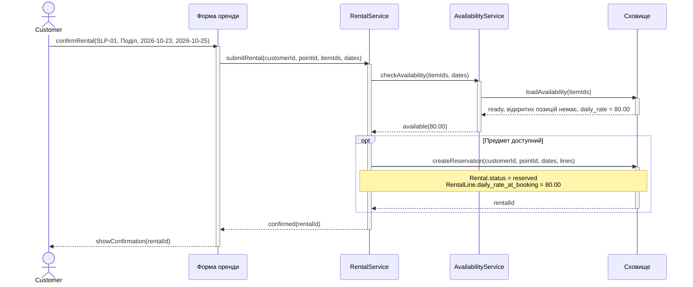
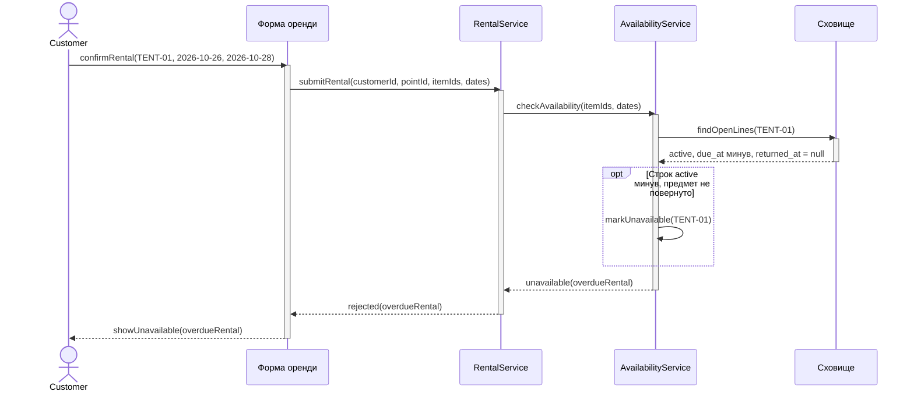
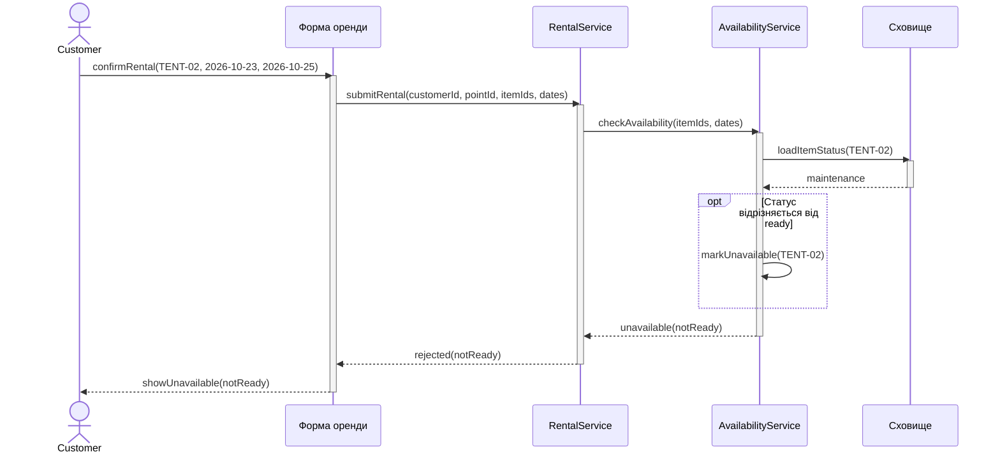
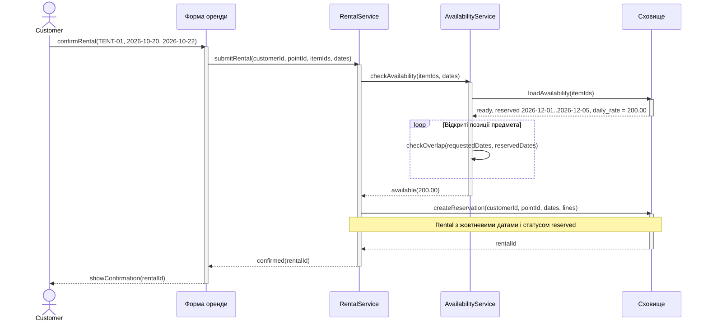
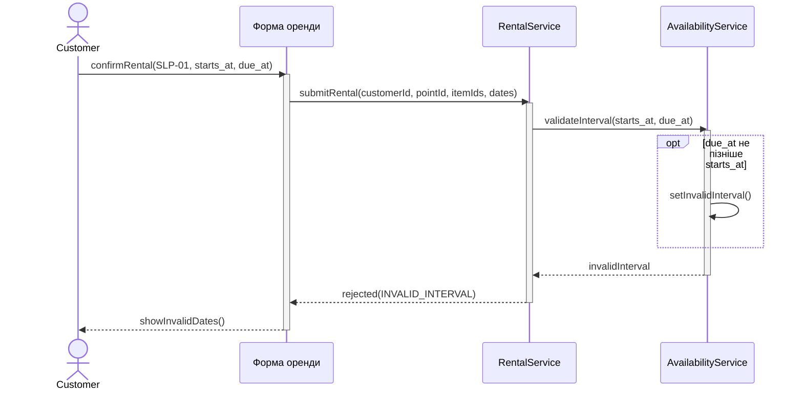
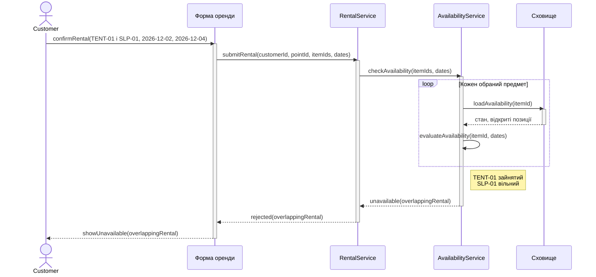

# Взаємодія під час оформлення оренди

Сценарії UC-02 з [завдання 2](../lab-2/requirements.md#3-сценарії-gherkin). Сховище працює із сутностями [ER-моделі](../lab-1/model.mmd).

## Сценарій 2. Бронювання вільного спальника

## Сценарій 3. Неповернений намет після due_at

## Сценарій 4. Предмет у ремонті

## Сценарій 9. Груднева бронь і жовтневі дати

## Сценарій 10. Неправильні дати

## Сценарій 12. Один зайнятий предмет відхиляє весь запит

